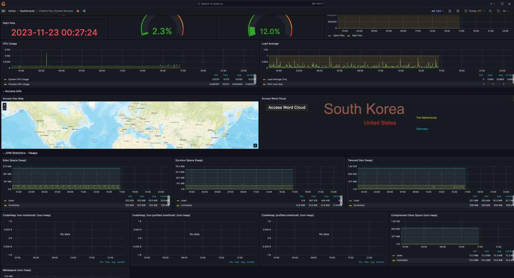

# ChatForYou v2 - WebRTC 화상채팅 & 게임 플랫폼
[]([LICENSE](https://creativecommons.org/licenses/by-nc-sa/4.0/) )
[](https://hits.seeyoufarm.com)

## 📋 프로젝트 개요
ChatForYou v2는 Node.js 프론트엔드와 Spring Boot 백엔드로 구성된 실시간 화상채팅 및 게임 플랫폼입니다.
WebRTC 기술을 활용한 N:M 화상채팅과 CatchMind 게임, 파일 공유 등 다양한 인터랙티브 기능을 제공합니다.

### 🏗️ 프로젝트 구조
```
ChatForYou_v2/
├── nodejs-frontend/          # Node.js 프론트엔드 서버 (포트: 3000)
│   ├── static/              # 정적 파일 (JS, CSS, 이미지)
│   ├── templates/           # HTML 템플릿
│   ├── config/              # 환경별 설정 파일
│   └── server.js            # Node.js 서버
├── springboot-backend/       # Spring Boot 백엔드 API (포트: 8443)
│   ├── src/main/java/       # Java 소스 코드
│   ├── src/main/resources/  # 설정 파일
│   └── build.gradle         # Gradle 빌드 설정
├── chatforyou-desktop/       # Electron 데스크톱 앱 (v1.1.5)
│   ├── src/                 # Electron 소스 코드
│   └── package.json
└── README.md
```

## 🛠️ 사용 기술

### Frontend
- **Node.js** - 프론트엔드 서버
- **Electron** - 데스크톱 앱 (v39)
- **jQuery** - DOM 조작 및 AJAX
- **Bootstrap 5** - UI 프레임워크
- **WebRTC** - 실시간 화상통신

### Backend
- **Java 17** - 프로그래밍 언어
- **Spring Boot** - 백엔드 프레임워크
- **Spring WebSocket** - 실시간 통신 (STOMP)
- **Kurento Media Server** - N:M 미디어 서버
- **Redis** - 분산 상태 관리 (방·라우팅·복구)
- **Kafka** - 인스턴스 간 이벤트 전파
- **MinIO** - 녹화 파일 오브젝트 스토리지

### Infrastructure
- **Docker** - 컨테이너화
- **Kubernetes** - 오케스트레이션 (RollingUpdate, readinessProbe)
- **GitHub Actions** - CI/CD 파이프라인
- **Prometheus & Grafana** - 성능 모니터링
- **nginx** - TLS sidecar + sticky session 라우팅

## ✨ 주요 기능

### 🎯 기본 기능
- **채팅방 관리**: 채팅방 조회, 생성, 삭제, 수정
- **무중단 배포 복구**: K8s Rolling Update 중 방 삭제 없이 자동 재입장 ([상세](#-무중단-배포-복구))
- **보안 기능**: 채팅방 암호화 및 접근 제어
- **사용자 관리**: 닉네임 중복 검사 및 자동 조정
- **실시간 메시징**: DataChannel 기반 실시간 채팅

### 🔄 무중단 배포 복구

Kubernetes Rolling Update 중 RTC 방이 삭제되지 않고, 참가자가 자동으로 같은 방에 재입장한다.

**동작 흐름**

| 단계 | 동작 |
|------|------|
| SIGTERM | `preStop` hook → `/internal/pre-shutdown` (loopback) → Redis에 복구 후보 메타데이터 저장 |
| readiness drain | 503 반환 → nginx가 이 Pod를 자동 제외 |
| WebSocket close | 프론트엔드 자동 재연결 + 배포 안내 카운트다운 오버레이(3분) 표시 |
| joinRoom() | owner unhealthy + 복구 메타 유효 → `REDIRECT_RECOVER` 반환 (기존 방 삭제 없음) |
| HTTP Recovery | `POST /chat/room/{roomId}/recover` → Redis claim lock → 신규 Pod로 owner 이전 → `Set-Cookie` 발급 |
| 재입장 | 새 쿠키로 신규 Pod에 WebSocket 연결 → `JOIN_ROOM` → 영상 복원 |

> `chatforyou-server`(nginx sticky) 쿠키는 HttpOnly라 JS에서 수정 불가. HTTP Recovery API 응답의 `Set-Cookie`로만 갱신된다.

**상세 문서**: `springboot-backend/ZERO_DOWNTIME_DEPLOY_FLOW.md`

---

### 🎥 화상채팅 기능
- **WebRTC 화상채팅**: N:M 음성/영상 통화 (Kurento Media Server)
- **화면 공유**: 실시간 화면 공유 기능
- **장비 선택**: 마이크/스피커 선택 기능
- **DataChannel**: 파일 전송 및 추가 채팅
- **텍스트 오버레이**: 문자 채팅 내용을 비디오에 표시
- **실시간 자막**: 음성을 통한 실시간 자막 기능
- **발화자 하이라이트**: 현재 말하고 있는 참가자의 비디오 타일을 실시간으로 강조 표시
- **SSE 기반 실시간 채팅 목록**: 서버 사이드 이벤트 기반 실시간 방 목록 갱신
- **녹화 기능**: 실시간 영상 녹화 및 MinIO 업로드/다운로드

### 🎮 게임 기능
- **CatchMind 게임**: N 라운드 그림 맞추기 게임
- **실시간 캔버스**: 실시간 그림 그리기
- **음성 인식**: 음성을 통한 정답 확인
- **모바일 지원**: 모바일 기기 터치 이벤트
- **Dynamic Topic**: ChatGPT 기반 동적 주제 생성

### 📁 파일 관리
- **MinIO Object Storage**: 실시간 파일 공유
- **파일 업로드/다운로드**: 이미지 파일 지원
- **용량 제한**: 최대 10MB
- **확장자 제한**: jpg, jpeg, png, gif

### 📊 시스템 관리
- **성능 모니터링**: Prometheus & Grafana (`/actuator/prometheus` 노출)
- **접속 차단**: Blacklist IP 관리
- **배치 작업**: 효율적인 방 관리
- **RESTful API**: 표준화된 API 설계

## 🌐 접속 정보
- **로컬 환경**: http://localhost:3000/chatforyou
- **운영 환경**: https://hjproject.kro.kr/chatforyou

## **_사이트 이용시 공시 사항_**
본 사이트는 오직 Spring Boot와 Node.js, JavaScript를 기본으로 하여 WebRTC 및 WebSocket 기술을 사용한 여러 기능을 공부하기 위한 사이트입니다.
**따라서 해당 사이트를 이용함에 있어 발생할 수 있는 모든 법적 책임은 사이트를 이용하시는 본인에게 있음을 명시해주시기 바랍니다.**

## **_Disclaimer when using this site_**
This site is only for studying various functions using WebRTC and WebSocket technologies based on Spring Boot, Node.js and JavaScript.
**Please note that all legal responsibilities that may arise from using this site are the responsibility of the person using the site.** 

## 🚀 구동 방법

### 1. 서버 아키텍처
https://github.com/SeJonJ/ChatForYou/wiki/%ED%94%84%EB%A1%9C%EC%A0%9D%ED%8A%B8-%EC%95%84%ED%82%A4%ED%85%8D%EC%B3%90

### 2. 사전 요구사항
- **Node.js** 22.13+ 설치 (프론트 Vite 빌드 요구사항, `nodejs-frontend/.nvmrc`)
- **Java 17** 설치
- **Kurento Media Server** 설치
- **TURN Server (coturn)** 설치
- **Redis** 설치
- **Kafka** 설치
- **MinIO** 설치

### 3. 프론트엔드 실행
```bash
cd nodejs-frontend

# 의존성 설치
npm install

# 로컬 환경 빌드
npm run local

# 서버 실행 (포트: 3000) — 시작 전에 Vite 빌드(dist)가 자동으로 실행된다
npm run start
```

### 4. 백엔드 실행
```bash
cd springboot-backend

# Gradle 빌드
./gradlew clean build

# JAR 실행 (포트: 8443, SSL)
java -Dkms.url=ws://[KMS_IP]:[PORT]/kurento -jar build/libs/*.jar
```

### 5. 데스크톱 앱 실행
```bash
cd chatforyou-desktop

# 의존성 설치
npm install

# 개발 모드 실행 (nodejs-frontend 를 빌드해 동기화한 뒤 앱을 띄운다)
npm start

# 동기화만 실행
node build-scripts/sync-frontend.js
```

`npm start` 와 빌드는 `nodejs-frontend` 에서 `npm run build` 를 실행하므로,
앞선 3단계(프론트엔드 실행)의 의존성 설치(`npm install`)가 끝나 있어야 한다.

### 6. 환경 설정

#### 프론트엔드 설정 파일
```javascript
// nodejs-frontend/config/config.local.js
window.__CONFIG__ = {
  API_BASE_URL: 'http://localhost:8443/chatforyou/api',
};

// nodejs-frontend/config/config.prod.js
window.__CONFIG__ = {
  API_BASE_URL: '{사용자 서비스 도메인}',
};
```

#### 백엔드 설정 파일
```properties
# application.properties
server.port=8443

# Kurento Media Server 설정
kms.url=ws://localhost:8888/kurento

# Redis
spring.data.redis.host=localhost
spring.data.redis.port=6379

# Kafka
spring.kafka.bootstrap-servers=localhost:9092
```

### 7. Docker 실행
```bash
# 프론트엔드 Docker 빌드
cd nodejs-frontend
docker build -t chatforyou-frontend .

# 백엔드 Docker 빌드
cd springboot-backend
docker build -t chatforyou-backend .

# Docker Compose 실행
docker-compose up -d
```

## 🔧 개발 도구

### Codegraph — 코드 인텔리전스

Codegraph는 프로젝트 소스를 분석해 심볼·호출 그래프·파일 간 의존 관계를 SQLite 지식 그래프로 인덱싱하는 로컬 도구입니다.
Claude Code(AI 에이전트)가 코드 탐색 질의를 처리할 때 사용하며, 팀원 모두가 로컬에 설치해야 합니다.

**설치 및 초기화**

```bash
# CLI 설치
npm install -g @codegraph/cli

# 프로젝트 루트에서 인덱스 생성 (최초 1회)
codegraph index

# 파일 변경 실시간 감지 (백그라운드 데몬)
codegraph start
```

**주요 기능**

| 기능 | 설명 |
|------|------|
| 심볼 검색 | 함수·클래스 이름으로 정의 위치 즉시 조회 |
| 호출 그래프 | "이 메서드를 호출하는 곳"·"이 메서드가 호출하는 곳" 추적 |
| 영향 분석 | 특정 심볼 변경 시 영향받는 파일/심볼 목록 |
| 흐름 추적 | A → B 경로를 동적 디스패치 포함해 한 번에 반환 |

> `.codegraph/` 디렉토리는 `.gitignore`에 등록되어 있으므로 각자 로컬에서 생성해야 합니다.
> 대규모 리팩토링 후 인덱스가 오래된 경우 `codegraph index --force` 로 재생성합니다.

---

### SAGE — PDCA 거버넌스 하네스

SAGE는 기능 개발을 00(기본 계획)~06(완료 보고) 단계로 강제하는 PDCA 거버넌스 프레임워크입니다.
Claude Code와 Codex 양쪽에서 동일하게 동작하며, 위험도(L0~L3)에 따라 필수 phase 문서·리뷰
루프·컨벤션 검증을 훅으로 강제합니다. 팀원 모두 로컬에 CLI를 설치해야 합니다.

**설치**

```bash
# CLI 설치 (pipx 권장)
pipx install "sage-harness[schema]"

# Claude Code 훅/스킬 설치 (이미 부트스트랩된 프로젝트에 합류하는 경우)
sage install --host claude --force

# Codex 훅/스킬 설치 (스킬은 레포 .codex/skills 에 설치)
sage install --host codex --skill-scope project-local --force

# 설치/버전/게이트 상태 확인
sage doctor
```

프로젝트 overlay(`sage/asset_overrides/`)는 레포에 설치된 스킬에만 합성됩니다. 그래서 Codex 도
`--skill-scope project-local` 로 설치해야 Claude와 같은 규칙으로 동작합니다. 전역
(`$CODEX_HOME/skills`)에 예전 SAGE 스킬이 남아 있으면 어느 쪽이 쓰일지 보장되지 않으므로
(`sage doctor` 가 중복으로 경고) 전역 사본은 지우세요.

**주요 명령**

| 명령 | 설명 |
|------|------|
| `sage cycle set <stem>` | 현재 작업의 PDCA 사이클(Cycle-Stem) 선언 |
| `sage validate --schema --kind all --strict` | profile/자산 전체 구조 검증 |
| `sage review-loop open/round/close` | Phase-05 리뷰 루프 감사 기록 |
| `sage retro` | 사이클 완료 후 회고·자산 개선 제안 |

자세한 사용법은 `AGENT_GUIDE.md`와 `docs/sage_harness/` 스펙 문서를 참고하세요.

---

## 📸 구동 화면

### 화상 채팅 화면


### DataChannel 파일 업로드/다운로드


### CatchMind 게임


### Grafana 성능 모니터링


### 실시간 자막 기능


### SSE 기능


## 📈 성능 개선
### CI/CD Pipeline with GitHub Actions for K8S Deployment
| 프로세스 단계       | 도입 전 소요시간 | 도입 후 소요시간 | 절감 시간 | 효율성 향상률 |
|---------------|-------------------|-------------------|-----------|----------------|
| **Gradle 빌드** | 105.2초          | 66초              | 39.2초    | 37.3% ↑        |
| **이미지 업로드**   | 25초             | 9초               | 16초      | 64.0% ↑        |
| **배포 자동화**    | 15초(수동)       | 14초(자동)        | 1초       | 6.7% ↑         |
| **전체 프로세스**   | 145.2초          | 89초              | 56.2초    | 38.7% ↑        |

## 🔗 관련 프로젝트
- **Python API Server**: [chatforyou-python-api](https://github.com/SeJonJ/chatforyou_python_api)
  - CatchMind 게임의 동적 주제 생성을 위한 ChatGPT 연동 서버

## 👥 팀 소개

| 역할 | 이름 | 담당 업무 | 이메일 | 프로필 |
|------|------|-----------|---------|---------|
| 👑 **프로젝트 리더** | 장세존 | 프로젝트 총괄 · 백엔드 · 프론트엔드 기능 개발 · DevOps 담당 | wkdtpwhs@gmail.com | [GitHub](https://github.com/SeJonJ) [Tistory](https://terianp.tistory.com) |
| ⚙️ **백엔드 개발** | 김동현 | 백엔드 · 프론트엔드 기능 개발 | `이메일 예정` | `GitHub 예정` |
| 💻 **풀스택 개발** | 박태식 | 백엔드 · 프론트엔드 기능 개발 | `이메일 예정` | `GitHub 예정` |
| 🎨 **디자인 및 웹 퍼블리싱 총괄** | 임가현 | 웹 퍼블리싱 · UI/UX 디자인 | `이메일 예정` | `GitHub 예정` |

### 📬 연락처
팀원들의 개별 연락처와 GitHub 프로필은 곧 업데이트될 예정입니다.

## 📚 Reference
- [WebRTC-SS](https://github.com/Benkoff/WebRTC-SS)
- [webrtc-lab](https://github.com/codejs-kr/webrtc-lab)
- [Kurento Documentation](https://doc-kurento.readthedocs.io/en/latest/index.html)
- [Progress Bar](https://kimmobrunfeldt.github.io/progressbar.js/)
- [Spinner](https://spin.js.org/)

## 📄 라이선스

Copyright 2024 SejonJang (wkdtpwhs@gmail.com)

이 프로젝트는 Creative Commons Attribution-NonCommercial-ShareAlike 4.0 International License 하에 라이선스됩니다.

**비상업적 사용만 허용됩니다:**
- ✅ 개인적, 교육적, 연구 목적의 사용
- ✅ 오픈소스 기여 및 개선
- ❌ 상업적 목적의 사용 및 배포
- ❌ 수익 창출을 위한 활용

자세한 내용은 [LICENSE](https://creativecommons.org/licenses/by-nc-sa/4.0/) 파일을 참조하세요.
